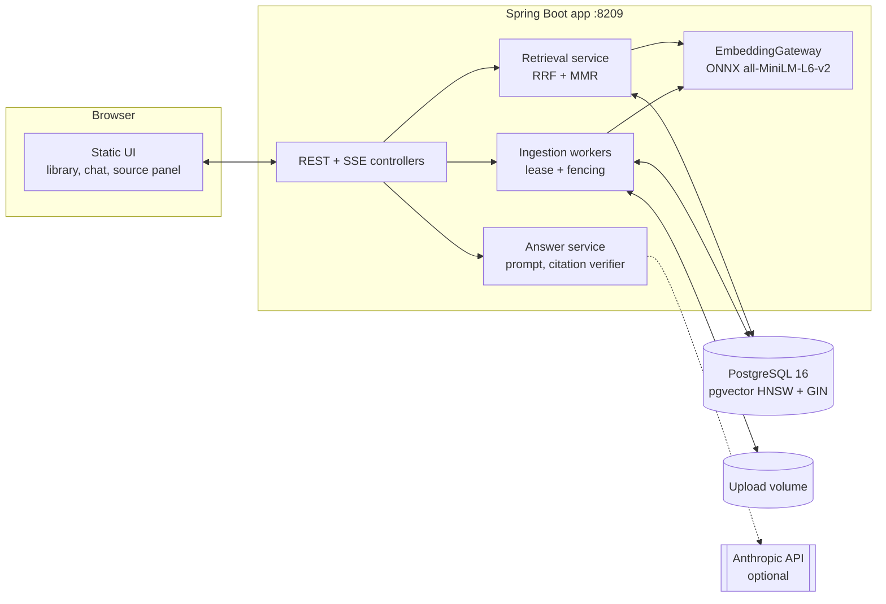
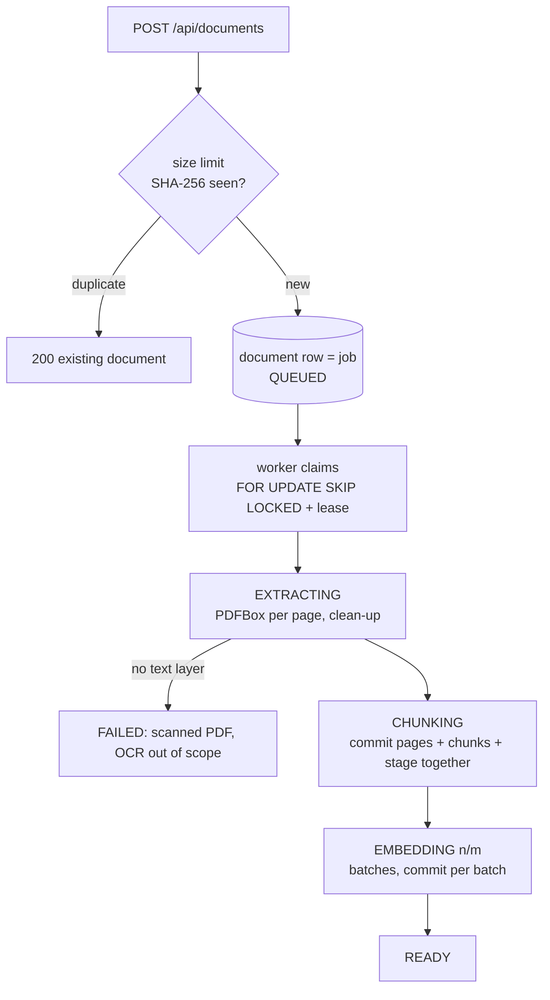
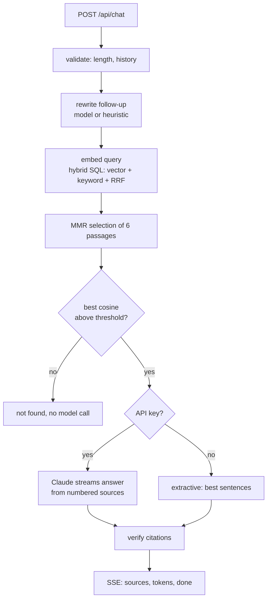

# docs-qa

A document question-answering service. Upload PDFs; they are extracted page by page, chunked, embedded
with a local model and stored in PostgreSQL with pgvector. Questions are answered from the stored text
with citations that the server checks: every `[n]` in an answer has to map to a passage that was really
supplied, and resolves to a document, a page and the exact quoted sentence. Retrieval is hybrid
(HNSW vector search and Postgres full-text search, fused with reciprocal rank fusion, written as one
hand-made SQL statement). With no API key the service still runs and answers extractively.

[](https://github.com/mgeladzerezo/docs-qa/actions/workflows/ci.yml)

Stack: Java 25, Spring Boot 4.1.1, Spring AI 2.0.1, PostgreSQL 16 + pgvector, Flyway, Apache PDFBox 3.

**Not exercised: the live Anthropic path.** No paid API was called while building this and no API key was
read or used. The generative path (Spring AI Anthropic chat model, streaming, usage reporting) is covered
only by tests that use a scripted fake `ChatModel`. Whether the real model follows the citation
instructions, and what a real answer costs, are untested here.

## Architecture



### Ingestion pipeline



### Query pipeline



## Quick start

```
docker compose up --build
```

Open <http://localhost:8209>. The four generated sample PDFs are ingested on first start (the library
shows queued, extracting, chunking, embedding n/m, ready). Try "What does error code E5 mean?", "What is the
nightly hotel limit in Zurich?" or "Which command performs a planned switchover?", then click a citation
chip to see the quoted sentence highlighted in its page, and switch on "Retrieval debug" to see each
candidate's vector rank, keyword rank and fused score.

To get generated answers instead of quoted passages, start with a key in the environment:
`ANTHROPIC_API_KEY=... docker compose up --build` (model `claude-sonnet-5-5`, override with
`DOCSQA_CHAT_MODEL`). Without a key the header badge says "Extractive mode" and every answer is labelled
as extractive in the UI and in the API (`mode`).

The Docker build downloads the embedding model and the native libraries it needs once (a `ModelWarmup`
step) and bakes them into the image, so the container does not need network access at run time. Postgres is
also published on host port 5549.

Local development: `docker compose up -d postgres`, then
`./mvnw spring-boot:run` (the model is downloaded on first start into `./data/models`; set
`DOCSQA_MODEL_CACHE_DIR` to put it elsewhere).

## HTTP API

| | |
|---|---|
| `POST /api/documents` (multipart `file`, optional `collection`) | 202 queued, 200 if the same bytes are already stored, 415 not a PDF, 413 too large, 429 backlog full |
| `GET /api/documents`, `GET /api/documents/{id}` | status, `chunksEmbedded`/`chunksTotal`, `failureReason` |
| `GET /api/documents/{id}/pages/{n}` | cleaned page text and its `charStart`: the coordinates citations use |
| `GET /api/documents/{id}/file`, `DELETE /api/documents/{id}` | the stored PDF, removal |
| `POST /api/chat` (JSON `question`, `history`, `documentIds`, `collection`, `debug`) | Server-Sent Events |
| `POST /api/search` (JSON `query`, `mode` = vector, keyword, hybrid) | the ranking of one mode |
| `GET /api/status` | mode (`generative` or `extractive`), embedding model and dimension |

The chat stream is `sources` (numbered passages, mode, whether retrieval was confident, and with `debug`
the whole fused ranking), then `token` events, then exactly one `done` (the verified answer, `citations`,
`invalidCitations`, `uncited`, usage, stop reason) or `error`. The streamed tokens are unverified text;
a client replaces them with `done.answer`, which is what the UI does.

## How it works

### 1. Restart-safe ingestion

A document row is its own job (`V1__schema.sql`): `status` is the stage and `locked_by`/`locked_until` is a
lease. [`IngestionRepository`](src/main/java/io/github/mgeladzerezo/docsqa/ingest/IngestionRepository.java)
claims work with `FOR UPDATE SKIP LOCKED`, treats an expired lease as free, and fences every write on
`locked_by`, so a worker that was presumed dead and wakes up later cannot overwrite the worker that took over
(it gets `LeaseLostException` and its transaction rolls back). Pages, chunks and the move to EMBEDDING commit
in one transaction; embedding commits per batch and resumes from the chunks whose `embedding` is still NULL.
A document that keeps killing its worker is failed after `max-attempts` instead of looping. Uploads are
hashed while they stream (size limit, SHA-256 de-duplication) and refused with 429 while the backlog is full.
Embedding batches pass through a semaphore in
[`EmbeddingGateway`](src/main/java/io/github/mgeladzerezo/docsqa/embedding/EmbeddingGateway.java), which is the
backpressure between the workers and the CPU-bound model.

### 2. Extraction and chunking

[`PdfTextExtractor`](src/main/java/io/github/mgeladzerezo/docsqa/ingest/PdfTextExtractor.java) strips one
page at a time, so page numbers are exact. [`TextAssembler`](src/main/java/io/github/mgeladzerezo/docsqa/ingest/TextAssembler.java)
removes running headers and footers (lines repeated at the top or bottom of most pages, ignoring digits),
undoes hyphenation, expands ligatures, joins paragraphs across page breaks and keeps an offset index of pages
and blocks. A PDF whose average extracted text per page is below 20 characters is rejected as scanned, with a
message that says OCR is out of scope; encrypted and oversized files are rejected with their own messages.

[`Chunker`](src/main/java/io/github/mgeladzerezo/docsqa/ingest/Chunker.java) is written from scratch:
sections (a heading and what follows) are packed greedily with whole sentences up to a target size, preferring
to end at a paragraph boundary; the next chunk starts with the last whole sentences of the previous one.

| parameter | value | reason |
|---|---|---|
| target | 180 tokens | all-MiniLM-L6-v2 reads at most 256 word pieces; 180 leaves room for the heading that is prepended to the embedded text and for the overlap |
| ceiling | 230 tokens | still under 256 after the heading; a chunk only exceeds the target to finish a paragraph |
| overlap | 40 tokens (whole sentences) | a fact stated across a boundary stays whole in at least one chunk, without doubling the index |
| minimum tail | 40 tokens | a short section tail is absorbed instead of becoming a fragment that matches everything |

Chunks never span a heading, so a chunk's `heading` is true for all of its text. Each chunk stores document
id, page range, character offsets and heading. The invariants (every non-blank character is covered, content
equals the text between the offsets, ceiling respected, sentence-aligned boundaries, exact page mapping) are
checked on more than 500 random documents in `ChunkerTest`. Token counts are a vocabulary-free estimate that
errs high; the eval run below also counts the real word pieces of every stored chunk.

### 3. Hybrid retrieval in one statement

[`SearchRepository`](src/main/java/io/github/mgeladzerezo/docsqa/retrieval/SearchRepository.java) builds
this statement (shown here for the unfiltered case; a document or collection filter adds
`AND c.document_id IN (...)` / `AND d.collection = ...` to both inner queries):

```sql
WITH vector_hits AS (
    SELECT id, row_number() OVER (ORDER BY distance, id) AS rank
    FROM (
        SELECT c.id, c.embedding <=> CAST(:queryVector AS vector) AS distance
        FROM chunk c JOIN document d ON d.id = c.document_id
        WHERE d.status = 'READY' AND c.embedding IS NOT NULL
        ORDER BY c.embedding <=> CAST(:queryVector AS vector)
        LIMIT :candidates
    ) nearest
),
keyword_hits AS (
    SELECT id, score, row_number() OVER (ORDER BY score DESC, id) AS rank
    FROM (
        SELECT c.id, ts_rank_cd(c.content_tsv, q.terms) AS score
        FROM chunk c JOIN document d ON d.id = c.document_id
        CROSS JOIN (SELECT to_tsquery('english',
                    replace(plainto_tsquery('english', :queryText)::text, '&', '|')) AS terms) q
        WHERE c.content_tsv @@ q.terms AND d.status = 'READY' AND c.embedding IS NOT NULL
        ORDER BY score DESC, c.id
        LIMIT :candidates
    ) matched
)
SELECT c.*, v.rank AS vector_rank, k.rank AS keyword_rank,
       1 - (c.embedding <=> CAST(:queryVector AS vector)) AS similarity,
       COALESCE(1.0 / (:rrfK + v.rank), 0) + COALESCE(1.0 / (:rrfK + k.rank), 0) AS score
FROM vector_hits v
FULL OUTER JOIN keyword_hits k ON k.id = v.id
JOIN chunk c ON c.id = COALESCE(v.id, k.id)
ORDER BY score DESC, c.id
LIMIT :limit
```

* The inner `ORDER BY embedding <=> $q LIMIT n` has exactly the shape pgvector needs to answer from the HNSW
  index (cosine operator class, nothing wrapped around the operator); ranks are assigned outside it, on the
  few rows that survive. `SearchRepositoryTest` runs `EXPLAIN` on the real statement and asserts that the HNSW
  and GIN indexes are used. Under a document filter the repository sets `hnsw.iterative_scan = strict_order`
  for the transaction, so the index keeps walking until enough rows pass the filter.
* `plainto_tsquery` ANDs the terms of a question, and a chunk rarely contains every word of a sentence.
  Rewriting `&` to `|` turns the match into "any term"; `ts_rank_cd` then prefers chunks with more terms,
  closer together, and in the heading (weight A against B for the body).
* Reciprocal rank fusion adds `1 / (60 + rank)` from each list. Only ranks are combined, so cosine distance
  and `ts_rank_cd`, which are on unrelated scales, never meet. The `FULL OUTER JOIN` keeps chunks found by
  only one side. Vector-only and keyword-only search are the same statement with one `WITH` branch replaced by
  an empty one, which is what the evaluation compares.
* The fused list (20 rows) goes to [`MmrSelector`](src/main/java/io/github/mgeladzerezo/docsqa/retrieval/MmrSelector.java)
  (lambda 0.7, 6 passages), because chunks overlap by design and a pure ranking tends to put several copies of
  the same passage on top.

### 4. Grounded answers and verified citations

[`PromptBuilder`](src/main/java/io/github/mgeladzerezo/docsqa/answer/PromptBuilder.java) puts numbered
`<source>` elements in the user message, tells the model to use only those, to cite as `[n]` and to reply
"Not found in the documents." otherwise. [`CitationVerifier`](src/main/java/io/github/mgeladzerezo/docsqa/answer/CitationVerifier.java)
then parses every marker (`[1]`, `[1, 3]`, `[2-4]`; a four-digit year in brackets is not a marker), removes the
numbers that match no supplied source and reports them, and resolves each valid number to the sentence of that
source closest to the statement carrying the marker (by embedding similarity). The quote is cut out of the
source text, so it is a real passage of the document, with its page and offsets. What the verifier does not
prove is that the quoted sentence actually supports the claim; that needs an entailment check (see below).

**Prompt-injection posture.** Retrieved text comes from files anybody may have uploaded. It is confined to
`<source>` elements in the user message, `<`, `>`, `&` and quotes in it are escaped so a passage cannot close
its element or open another, and the system message states that nothing inside the sources is an instruction.
The model is given no tools and no data beyond the passages, so a successful injection can change the wording
of an answer but cannot reach anything else; the citation check then exposes claims that do not map to a
source. This lowers the risk and does not remove it. `PromptBuilderTest` checks the escaping and that no
retrieved text reaches the system message.

**No-key mode.** [`ExtractiveAnswerer`](src/main/java/io/github/mgeladzerezo/docsqa/answer/ExtractiveAnswerer.java)
returns up to three passages, each represented by its sentence closest to the question, quoted verbatim with
its citation. Nothing is generated, paraphrased or judged; the API and the UI say "extractive".

**Guardrails.** If the best cosine similarity among the candidates is below 0.30 the answer is "not found"
without asking a model. Questions are limited to 1000 characters (400 before the stream opens), uploads and
questions are rate limited per client address with a token bucket, and uploads are limited in size, page count
and backlog. **Follow-ups** are rewritten into standalone queries by the model when there is one, and by a
heuristic otherwise (a dependent question gets the previous question appended; both retrieval branches only
need the right words to be present).

## Evaluation

The corpus is four PDFs generated at build time with PDFBox from original text in
`src/main/resources/corpus/` (an espresso machine manual, a hiking trail guide, a database runbook, a travel
policy; 5 pages each, 38 chunks). The golden set,
[`src/test/resources/eval/golden.tsv`](src/test/resources/eval/golden.tsv), has 34 answerable questions with
the expected page (14 paraphrased so that they share few words with the source, 15 plain, 5 built around an
identifier such as an error code or form number) and 7 unanswerable ones, 4 of which are deliberately close to
the corpus in topic. A chunk counts as relevant if its page range contains an expected page.

```
./mvnw -Peval verify
```

This starts a pgvector Testcontainer, ingests the corpus with the real all-MiniLM-L6-v2 model (downloaded on
first use, about 90 MB, plus the native libraries it needs) and writes `target/eval/report.md`. It is a
separate profile because of that download; the default `verify` uses a fake embedding model.

The figures below are from one run on 7 October 2026 on a 16-thread Windows desktop that was busy with other
builds, against the working tree that became commit `a21c82a`. The full report of that run is in
[`docs/eval-report.md`](docs/eval-report.md). The run has not been repeated since; the only later change to
the evaluation is an added check that no chunk exceeds the model's input limit, which has never been executed.

Retrieval on the 34 answerable questions:

| method | recall@1 | recall@3 | recall@5 | recall@6 | MRR@10 |
|---|---|---|---|---|---|
| vector only (HNSW, cosine) | 0.853 | 1.000 | 1.000 | 1.000 | 0.926 |
| keyword only (tsvector, `ts_rank_cd`) | 0.765 | 0.853 | 0.882 | 0.912 | 0.828 |
| hybrid (RRF, k=60) | 0.882 | 0.971 | 1.000 | 1.000 | 0.924 |
| hybrid + MMR (the passages given to the model) | 0.882 | 0.882 | 0.941 | 0.941 | 0.896 |

MRR@10 by question kind:

| method | paraphrase (14) | plain (15) | exact (5) |
|---|---|---|---|
| vector only | 0.929 | 0.933 | 0.900 |
| keyword only | 0.654 | 0.933 | 1.000 |
| hybrid (RRF) | 0.863 | 0.956 | 1.000 |

Abstention with the similarity threshold of 0.30:

| | questions | abstained | best similarity min / mean / max |
|---|---|---|---|
| unanswerable | 7 | 3 (43%) | 0.12 / 0.39 / 0.70 |
| answerable | 34 | 2 (6%) | 0.26 / 0.51 / 0.79 |

What the numbers say:

* **Hybrid does not beat vector-only on this corpus.** It is one question better at rank 1 (0.882 against
  0.853), one question worse at rank 3, and equal on MRR within noise. Its gain is on the identifier
  questions (error codes, form numbers), where keyword search is perfect and vectors are not; its loss is on
  paraphrases, where the keyword branch pulls weaker passages up. With 34 questions, one question is 0.03.
* **MMR costs recall here.** Diversifying the six passages given to the model dropped the expected page for
  two questions that plain hybrid had in its top five. On a corpus this small there are few near-duplicates
  to remove, so the diversity step has little to gain.
* **The threshold is a weak guard.** Four of the seven unanswerable questions pass it, three of them the ones
  written to be close to the corpus in topic, and two answerable questions are wrongly refused. The similarity
  ranges of the two groups overlap (0.26 to 0.79 against 0.12 to 0.70), so no threshold separates them; the
  grounded prompt has to do the refusing, and that was not tested with a real model.

Mean search time in that run was 250 ms per query (embedding the query plus the SQL) over 102 searches, on a
loaded machine; treat it as an upper bound for this hardware, not a benchmark.

## Design decisions

* **The document row is the job queue.** No broker: Postgres already holds the state, `SKIP LOCKED` gives
  exclusive claims, and the lease plus fenced writes make crashes safe. A broker would add a second system
  that has to agree with the database about what was done. The cost is polling (1 s) and the database being
  the throughput limit, which is irrelevant at PDF-ingestion rates.
* **Spring AI is wired by hand, not through its starters.** The chat model bean must not exist without a key
  (its absence is what switches the service to extractive mode and heuristic rewriting) and the embedding
  model has to be swappable behind `EmbeddingGateway`, which also stores a name and dimension with every
  document; `EmbeddingProfileGuard` refuses to start if the configured model does not match the schema or the
  stored documents, so two models are never mixed in one index.
* **One SQL statement for all three retrieval modes**, so the evaluation compares the real implementation
  and not three separate code paths.
* **RRF over score blending.** It needs no normalisation of two incomparable scores and has one parameter.
* **Local embeddings.** The demo works offline of any provider. The cost is a larger image and a 256-token
  input limit, which drives the chunk size. A hosted model can be configured with `docsqa.embedding.provider`
  set to anything but `onnx` plus the matching Spring AI module.
* **Quotes by embedding similarity, not word overlap**, because answers paraphrase the source. It costs one
  small local batch per answer.
* **Rejected: OCR** (out of scope, scanned files fail with a clear reason), **a re-ranking model** (see below),
  **an in-memory vector store** (restart safety and filters are the point).

## Testing

`./mvnw verify` (needs Docker for Testcontainers; no model download, no API key).

| test class | what it proves |
|---|---|
| `ChunkerTest` | coverage, offsets, ceiling, overlap, sentence alignment and heading invariants on 500+ random documents; exact page ranges |
| `PdfExtractionTest`, `TextAssemblerTest`, `SentenceSplitterTest` | per-page extraction on generated PDFs, header/footer removal, hyphenation, ligatures, page-break joins, scanned/encrypted/oversized rejection |
| `IngestionFlowTest` | upload to READY on real pgvector; duplicates; scanned PDFs fail with a reason; size limit while streaming; delete |
| `IngestionRestartTest` | a worker dying mid-embedding is replaced without redoing committed batches; concurrent workers never claim the same document; a stale worker's writes are rejected; retry, backoff, attempt limit; graceful shutdown; backlog limit |
| `SearchRepositoryTest` | ranking, exact RRF arithmetic, filters, unfinished documents invisible, EXPLAIN shows HNSW and GIN used, filtered vector search still returns the requested rows |
| `MmrSelectorTest` | near-duplicates lose to distinct passages; lambda 1 keeps the order |
| `CitationVerifierTest`, `PromptBuilderTest`, `QueryRewriterTest` | invalid citation numbers removed and reported, quotes verbatim with the right page, escaping of retrieved text, model and heuristic rewrite |
| `ChatFlowTest` | the SSE contract end to end with a scripted `ChatModel` (sources, tokens, one done; a made-up `[9]` is stripped; quote found at its offset on the stored page; not-found without a model call; follow-up rewriting; document filter; debug ranking; model failure becomes an `error` event; 400 before the stream) |
| `ExtractiveChatFlowTest` | no key: extractive label, verbatim quotes at their offsets, not-found |
| `RateLimiterTest` | burst, refusal with retry delay, refill |
| `RetrievalEvaluationTest` (`-Peval`) | the measured table above; sanity floors only |

## Cost and latency notes

Apart from the mean search time in the evaluation run above, no latency, throughput or cost figure has been
measured for this repository, so none is given. For reasoning
about cost: one question sends the system prompt plus up to six passages of at most 230 estimated tokens each,
and retrieval itself makes no paid call (embeddings are local); follow-up rewriting adds one short model call.
The model call dominates both cost and latency, and the stream shows the sources before the first token. The
evaluation run also prints mean search time and ingestion time.

## Known limitations

* **What was run and what was not.** The test classes of the ingestion and chunking commits (`0a5931f`, `ab16e61`)
  passed when those commits were made. The retrieval, answer, web, UI, eval, Docker and CI work added
  afterwards was compiled and its tests were run once, but not again in the final state: nothing was re-run
  after the last edits (the eval test's tokenizer check, `ModelWarmup`, this README), and the retrieval
  evaluation was run once, before those edits (see [Evaluation](#evaluation)). Treat the final tree as
  compiled, not verified. **The Docker image and the compose file
  were never successfully built and started**; the image build was interrupted. The UI was written but never
  opened in a browser.

* **The live Anthropic path was never run** (no key was used; see the top of this file). Request options follow
  the documented Messages API for `claude-sonnet-5-5` (no sampling parameters, adaptive thinking, effort set
  through `output_config.effort`), but they are unverified against the real service.
* Citation verification checks that a citation maps to a supplied source and quotes a real sentence of it. It
  does not check that the sentence supports the claim.
* The similarity threshold of 0.30 was set before the evaluation and was not tuned on it. On the golden set it
  lets some unanswerable questions through; see the abstention table. In that case the model is asked and has to
  say "not found" itself, which was not tested with a real model.
* The corpus is small (38 chunks, 4 documents). With so few chunks, differences between retrieval methods are a
  matter of a question or two, and the numbers say little about large libraries. Run-to-run results can differ
  slightly because ties are broken by chunk id, which changes between runs.
* Scanned PDFs are rejected; there is no OCR. Multi-column layouts follow PDFBox's position order. A genuinely
  hyphenated compound broken at its hyphen loses the hyphen.
* Rate limiting is per instance and keyed by socket address (behind a proxy that is the proxy's address).
* There is no authentication or per-document access control: every document is visible to every client.
* CI was not run (no remote).

## What a production system would add

* OCR (for example a Tesseract or cloud OCR stage ahead of extraction) for scanned documents.
* Per-document or per-collection access control, enforced inside the retrieval SQL and not only in the UI.
* A cross-encoder re-ranker over the fused top 20, which is where retrieval quality is usually won.
* Answer faithfulness evaluation: an entailment or LLM-judge check that each cited sentence supports its claim,
  and a regression set run against the generative path.
* Rate limits at a gateway keyed by authenticated user, a shared limiter, metrics and tracing around the model call.
